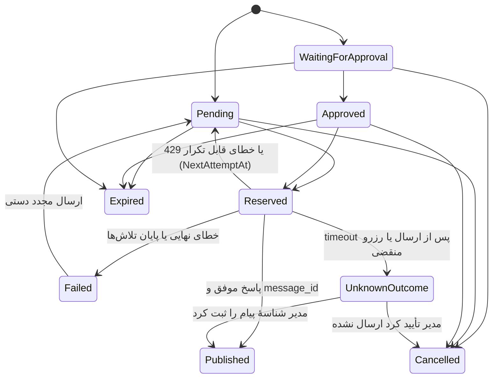

# طراحی انتقال «فوتبال فوری» به ChannelPilot

**وضعیت:** پیش‌نویس برای تأیید (تسک F0.1). تا تأیید این سند، کدی نوشته نمی‌شود.

**مرجع:** پروژهٔ آرشیوی `C:\Projects\TelegramAggregator` فقط خوانده می‌شود و تغییر نمی‌کند.

## ۱. هدف و محدوده

«فوتبال فوری» اولین کانال عملیاتی ChannelPilot می‌شود. منطق جمع‌آوری، فیلتر، حذف تکراری، امتیازدهی و ساخت کپشن از پروژهٔ قدیمی منتقل می‌شود. صف و انتشار از صف مشترک ChannelPilot عبور می‌کنند و از پنل مرکزی مدیریت می‌شوند.

- ChannelPilot با صف و تاریخچهٔ خالی شروع می‌کند. داده‌ای از PostgreSQL قدیمی وارد نمی‌شود.
- ارسال خودکار به کانال اصلی فقط بعد از آزمون روی کانال آزمایشی و طی روال جابه‌جایی (بخش ۱۴) فعال می‌شود.
- ترند و رمان در این مرحله فقط وضعیتشان در پنل نمایش داده می‌شود.

## ۲. نگاشت پروژهٔ قدیمی به لایه‌های جدید

| پروژهٔ قدیمی | ChannelPilot | لایه |
|---|---|---|
| `News`، `NewsStatus`، `NewsHistory` | `ContentItem` + `FootballNewsItem` + `PublishQueueItem` + `PublishedPost` | Domain |
| `SportSourceEnumeration` و تشخیص منبع از عنوان فید | رکورد `ContentSource` با نوع آداپتور | Domain / داده |
| `TextCleaner` و پاک‌کننده‌های هر سایت | `Football/Text/*` | Application |
| `TextSimilarity` | `Football/Deduplication/TextSimilarity` | Application |
| `ScoreCalculator` + `footbalScoring.json` | `FootballScoreCalculator` + `FootballScoringOptions` | Application |
| `CaptionMakerExtension` | `FootballCaptionService` | Application |
| `NewsRepository.ProcessNewsAsync` | `FootballNewsProcessingService` | Application |
| `RssParserService`، `HttpHelperService` | `RssContentSourceReader` | Infrastructure |
| `ImageExtractorService`، `FullDecriptionExtractorService` | `ArticlePageEnricher` (یک بار دریافت صفحه) | Infrastructure |
| `PlaywrightService`، `Football360ScraperService` | `PlaywrightBrowserProvider`، `Football360SourceReader` | Infrastructure |
| ارسال کامنت‌شده با `Telegram.Bot` | `TelegramBotApiPublisher` پشت `ITelegramPublisher` | Infrastructure |
| `FootballforiBackgroundService` | `FootballNewsWorker` + `PublishQueueWorker` | Worker |
| `DashboardController`، `debug.html` | API + پنل Razor Pages | Api |

## ۳. منابع و آداپتورها

نمونه‌های واقعی در `backend/tests/ChannelPilot.UnitTests/Fixtures/Football` ذخیره شده‌اند (۱ آذر ۱۴۰۵ / 2026-11-21).

| منبع | آداپتور | آدرس | نکته‌های نمونهٔ واقعی |
|---|---|---|---|
| ورزش سه | `Rss` | `https://www.varzesh3.com/rss/all` | به `www.varzesh3.ir` منتقل می‌شود. `pubDate` بدون منطقهٔ زمانی است و به وقت تهران تفسیر می‌شود. ۴۰ آیتم دارد و تصویر صفحه‌ها `.webp` است. |
| طرفداری | `Rss` | `https://www.tarafdari.com/static/page/taxonomy/all/feed.xml` | به `/rss/rss` منتقل می‌شود. عنوان فید CDATA است. تصویر `.webp` است. |
| خبرورزشی | `Rss` | `https://www.khabarvarzeshi.com/rss` | `enclosure` تصویر دارد و نیازی به استخراج تصویر از صفحه نیست. لینک‌ها percent-encoded هستند. |
| فوتبال ۳۶۰ | `Football360` | `https://football360.ir/` | فهرست خبرها، متن کامل (`post.body`)، تصویر و زمان انتشار در JSON `__NEXT_DATA__` هستند. |

قواعد:

- نوع آداپتور در `ContentSource` ذخیره می‌شود. تشخیص منبع از روی عنوان فید، که در پروژهٔ قدیمی بود، حذف می‌شود.
- منبع غیرفعال خوانده نمی‌شود. خطای هر منبع در `FailureCount`، `LastFetchedAt` و آخرین پیام خطا ثبت می‌شود و جمع‌آوری از بقیهٔ منابع ادامه پیدا می‌کند.
- از هر منبع ۱۰ خبر آخر خوانده می‌شود و این عدد قابل تنظیم است.
- **Playwright برای فوتبال ۳۶۰ الزامی است.** مرورگر Chromium یک بار ساخته می‌شود (singleton) و برای هر دور جمع‌آوری یک context جدا گرفته می‌شود. بهبود این است که داده از `__NEXT_DATA__` خوانده می‌شود. نسخهٔ قدیمی به کلاس‌های CSS هش‌شده مثل `style_subTitle__iNvlW` وابسته بود که با هر انتشار سایت عوض می‌شوند. خبرهای لایو، زنده و فانتزی کنار گذاشته می‌شوند. بخش «لایو 360» صفحهٔ اصلی هم خوانده نمی‌شود.
- برای سه منبع RSS، صفحهٔ هر خبر فقط یک بار با `HttpClient` دریافت و با AngleSharp تحلیل می‌شود. متن کامل، تصویر اصلی (`og:image` و سپس امتیازدهی تصاویر مقاله) و تشخیص ویدئو همه از همین یک بار دریافت به دست می‌آیند. نسخهٔ قدیمی هر خبر را سه بار جداگانه در مرورگر باز می‌کرد.
- نمونه‌ها نشان دادند که HTML خام سه منبع RSS برای استخراج کافی است. اگر در آزمون معلوم شود منبعی به اجرای JavaScript نیاز دارد، همان منبع به Playwright منتقل می‌شود.

## ۴. ترتیب پردازش هر دور جمع‌آوری

1. خواندن منابع فعال
2. پاک‌سازی عنوان و خلاصه
3. استانداردسازی URL و حذف URLهایی که قبلاً دیده شده‌اند
4. فیلتر کلیدواژه روی عنوان و خلاصه، پیش از دریافت صفحه تا درخواست بیهوده‌ای فرستاده نشود
5. تکمیل از صفحهٔ خبر: متن کامل، تصویر، ویدئو
6. بررسی شباهت با خبرهای ۸ ساعت اخیر و خبرهای همین دور
7. امتیازدهی روی متن کامل
8. بررسی شرایط ارسال (بخش ۸)
9. ذخیرهٔ `ContentItem` و `FootballNewsItem` با وضعیت و دلیل
10. ساخت کپشن و سپردن خبر واجد شرایط به صف

همهٔ خبرهای دیده‌شده ذخیره می‌شوند، از جمله خبرهای ردشده با دلیل رد. این کار دو هدف دارد: URL تکراری دوباره پردازش نمی‌شود و پنل می‌تواند علت رد را نشان دهد.

## ۵. فیلترها و دلایل رد

دلیل رد در enum `FootballRejectionReason` تعریف می‌شود و برای نمایش جزئیات، متن کلیدواژهٔ تطبیق‌یافته هم کنارش ذخیره می‌شود.

| دلیل | قاعده |
|---|---|
| `OtherSport` | کلیدواژه‌های `OtherSportsKeywords` (کشتی، والیبال، UFC، مجلس، دولت و…) |
| `WomenFootball` | کلیدواژه‌های `WomenKeywords` |
| `VideoTitle` | کلیدواژه‌های `VideoKeywords` در عنوان یا خلاصه |
| `ExcludedTopic` | ترکیب رسمی، برنده‌های پیش‌بینی، جدول پخش زنده، پخش بازی، روزنامهٔ خبرورزشی |
| `DuplicateUrl` | URL استانداردشده قبلاً ثبت شده است |
| `SimilarContent` | شباهت ۹۰٪ یا بیشتر با خبر قبلی |
| `NoImage` | تصویر معتبری پیدا نشد |
| `HasVideo` | صفحه ویدئو دارد |
| `IncompleteBody` | دریافت متن کامل شکست خورد یا متن کوتاه‌تر از حد مجاز است |
| `BeforeCutover` | زمان انتشار معتبر پیش از زمان جابه‌جایی است |
| `BelowThreshold` | امتیاز نرمال‌شده کمتر از آستانهٔ کانال است |
| `Expired` | تا پایان روز انتشار ارسال نشد |

فهرست کلیدواژه‌ها در تنظیمات (`FootballFilterOptions`) نگه داشته می‌شود. ویرایش آن‌ها از پنل در این مرحله انجام نمی‌شود.

## ۶. حذف تکراری

- **URL استاندارد:** percent-decode، حروف کوچک، حذف query و fragment و اسلش انتهایی. ترکیب `(SourceId, NormalizedUrl)` ایندکس یکتا دارد.
- **شباهت متن:** الگوریتم Levenshtein نرمال‌شده با یکسان‌سازی حروف فارسی و عربی منتقل می‌شود. مقایسه روی عنوان و خلاصه انجام می‌شود. در نسخهٔ قدیمی متن کامل هم وارد مقایسه می‌شد و چون الگوریتم از نظر طول درجه‌دو است، کار کند و پرهزینه بود.
- **بهبود:** نسخهٔ قدیمی خبرهای جدید را پیش از مقایسه ذخیره می‌کرد، پس دو خبر مشابه یکدیگر را رد می‌کردند و هیچ‌کدام منتشر نمی‌شد. در طراحی جدید، خبرِ دیرتر دیده‌شده با خبرهای قبلی و خبرهای پیش از خودش در همان دور مقایسه می‌شود و فقط خودش رد می‌شود.
- **بهبود:** خبرهای یک منبع هم با هم مقایسه می‌شوند. نسخهٔ قدیمی این مقایسه را انجام نمی‌داد.
- `ContentHash` برای تشخیص سریع متن کاملاً یکسان استفاده می‌شود.

## ۷. امتیازدهی

منطق `ScoreCalculator` بدون تغییر معنایی منتقل می‌شود:

- از هر دسته (کنفدراسیون، تیم، چهره، بازیکنان پرسپولیس، بازیکنان استقلال، مربی) بیشترین امتیاز تطبیق‌یافته جمع زده می‌شود.
- مفسر، خبرگزاری، نقل‌وانتقال، مصدومیت شدید، برچسب انحصاری، دربی و تازگی وزن خودشان را دارند (تازگی: زیر ۳۰ دقیقه وزن کامل، زیر ۶۰ دقیقه نصف وزن).
- امتیاز خام در بازهٔ ۰ تا ۲۰۰ محدود می‌شود.

بهبودها:

- امتیاز روی متن کامل حساب می‌شود. نسخهٔ قدیمی امتیاز خبرهای RSS را پیش از دریافت متن کامل حساب می‌کرد.
- وزن‌های `Conferences` و `IranianPlayer` در JSON بودند ولی کلاس متناظر نداشتند و نادیده گرفته می‌شدند. در طراحی جدید هر وزن تعریف‌شده واقعاً اعمال می‌شود. برای وزن‌هایی که هنوز در فرمول جایی ندارند، هنگام راه‌اندازی هشدار ثبت می‌شود.
- تطبیق کلیدواژه با مرز کلمه انجام می‌شود تا نام‌های کوتاه داخل کلمه‌های دیگر تطبیق نخورند.
- جزئیات امتیاز (کدام سیگنال‌ها و چند امتیاز) ذخیره می‌شود و در پنل قابل مشاهده است.

**نگاشت به ۰ تا ۱۰۰:** `Normalized = round(Raw / 2)`. این نگاشت خطی است و ترتیب خبرها را حفظ می‌کند. مقدار نرمال‌شده در `ContentQualityScore.FinalScore` ذخیره می‌شود.

آستانهٔ اولیهٔ ۷۰ معادل امتیاز خام ۱۴۰ است و در پروژهٔ قدیمی آستانه‌ای وجود نداشت: پرامتیازترین خبر صف بدون توجه به عدد امتیازش ارسال می‌شد. پس ۷۰ احتمالاً برای بیشتر خبرها سخت‌گیرانه است. در F10.3 توزیع امتیاز روی نمونهٔ واقعی با ارسال خاموش اندازه‌گیری می‌شود و آستانه از پنل تنظیم می‌شود.

پیشنهاد سیاست برای تأیید: خبر زیر آستانه رد نمی‌شود. در صف با اولویت پایین‌تر می‌ماند، ولی تا آستانه از پنل پایین نیاید ارسال نمی‌شود. این رفتار نزدیک‌ترین رفتار به پروژهٔ قدیمی است و هیچ خبری به‌خاطر آستانهٔ اشتباه از دست نمی‌رود. گزینهٔ دیگر رد مستقیم با دلیل `BelowThreshold` است.

## ۸. شرایط ارسال

یک خبر فقط وقتی به صف می‌رود که همهٔ این شرط‌ها برقرار باشد:

- تصویر معتبر دارد؛ تصویرهای لوگو، آیکون، آواتار، بنر و تبلیغ، یا تصویر کوچک‌تر از حد مجاز، معتبر نیستند.
- صفحهٔ خبر ویدئو ندارد: تگ `video`، فایل‌های mp4 و m3u8، یا iframe یوتیوب، آپارات، تماشا، اینستاگرام، تیک‌تاک، ویمئو و ویدئوی ورزش سه.
- متن کامل با موفقیت دریافت شده و طولش از حداقل مجاز بیشتر است. نسخهٔ قدیمی برای تشخیص این حالت دنبال رشتهٔ «خطا در دریافت محتوا» در متن می‌گشت. در طراحی جدید شکست دریافت یک نتیجهٔ صریح است.
- `PublishedAt` معتبر و پس از زمان جابه‌جایی کانال است. خبری که تاریخ انتشار ندارد یا تاریخ انتشارش در آینده است، از زمان جمع‌آوری استفاده می‌کند و این موضوع در جزئیات خبر ثبت می‌شود.

## ۹. کپشن

- عنوان بولد، سپس خلاصه، سپس متن اصلی. فوتر از تنظیمات کانال خوانده می‌شود؛ در نسخهٔ قدیمی `@FOOTBALFORI` و `#iman` در کد ثابت بودند.
- خروجی HTML امن است: محتوای متنی escape می‌شود.
- سقف ۱۰۲۴ کاراکتر رعایت می‌شود و برش در پایان آخرین جملهٔ کامل انجام می‌شود. طول بعد از escape و بر اساس واحدهای UTF-16 محاسبه می‌شود، همان واحدی که تلگرام می‌شمارد.
- نام منبع‌ها حذف می‌شود («به گزارش طرفداری»، «ورزش سه |» و…). جملهٔ «به گزارش فوتبال 360» در نسخهٔ قدیمی با «به گزارش فوتبال فوری» جایگزین می‌شد. این جایگزینی به ادعای گزارش اختصاصی تبدیل می‌شود، پس پیشنهاد می‌کنم جمله فقط حذف شود. همین‌طور جملهٔ «در گفت‌وگو با خبرنگار فوتبال فوری» حذف می‌شود.

## ۱۰. مدل داده

این تغییرات در Domain انجام می‌شوند و Domain بدون کد زیرساخت می‌ماند:

- **`ContentSource`:** `AdapterType` (`Rss`، `Football360`)، `FeedUrl`، `LastError`، `LastErrorAt`
- **`ContentItem`:** `NormalizedUrl`، `PublishedAtIsEstimated`. `OriginalBody` متن کامل را نگه می‌دارد. همهٔ زمان‌ها UTC هستند.
- **`FootballNewsItem`:** `RawScore`، `NormalizedScore`، `ScoreBreakdownJson`، `RejectionReason`، `RejectionDetail`
- **`TelegramChannel`:** `PublishingEnabled` (کلید ارسال، پیش‌فرض خاموش)، `CutoverAt`، `CaptionFooter`، `PublishWindowStart` و `PublishWindowEnd`
- **`PublishQueueItem`:** `Priority` (امتیاز)، `ReservedUntil`، `ReservationToken`، `NextAttemptAt`، `LastError`، `RowVersion`
- **`PublishStatus`:** به‌جز وضعیت‌های فعلی، سه وضعیت `Reserved`، `UnknownOutcome` و `Expired` اضافه می‌شوند.
- **`PublishedPost`:** برای هر آیتم صف حداکثر یک رکورد (ایندکس یکتا روی `PublishQueueItemId`). `TelegramMessageId` الزامی است.

تغییر وضعیت‌های مجاز صف:

مقدارهای فعلی `Scheduled` و `Publishing` در طراحی جدید استفاده نمی‌شوند. زمان‌بندی با `ScheduledFor` انجام می‌شود و `Reserved` جای `Publishing` را می‌گیرد. پیشنهاد این است که این دو مقدار در همین migration حذف شوند، چون هنوز داده‌ای از آن‌ها استفاده نمی‌کند.

## ۱۱. صف و انتشار

**رزرو اتمیک:** یک دستور SQL با `UPDATE TOP (1) ... WITH (UPDLOCK, READPAST, ROWLOCK)` یک آیتم واجد شرایط را به `Reserved` می‌برد و `ReservationToken` و `ReservedUntil` را می‌نویسد. ترتیب انتخاب بر اساس `Priority` نزولی و سپس زمان ورود است. با این روش دو worker هرگز یک آیتم را با هم برنمی‌دارند.

**کنترل‌های پیش از ارسال (`PublishingGate`):** همهٔ این کنترل‌ها برای ارسال خودکار و ارسال دستی یکسان اجرا می‌شوند:

1. کانال فعال است و `PublishingEnabled` روشن است.
2. اگر کانال تأیید لازم دارد، آیتم تأیید شده است.
3. زمان `ScheduledFor` و `NextAttemptAt` رسیده است.
4. ساعت فعلی داخل پنجرهٔ انتشار است.
5. حداقل ۱۰ دقیقه از آخرین ارسال کانال گذشته است.
6. تعداد پست‌های روز به سقف ۴۰ نرسیده است.
7. همین محتوا قبلاً در این کانال ارسال نشده است.

اگر یکی از کنترل‌ها رد شود، رزرو آزاد می‌شود و آیتم بدون شمارش تلاش به `Pending` برمی‌گردد.

**روز انتشار:** پنجرهٔ انتشار از ۸ صبح تا ۳ بامداد به وقت تهران است و از نیمه‌شب عبور می‌کند. اگر روز تقویمی ملاک باشد، یک دورهٔ کاری دو سقف جدا می‌گیرد. پیشنهاد این است که «روز انتشار» از ۸ صبح تهران شروع شود و سقف روزانه روی همین روز شمرده شود. داشبورد قدیمی هم آمار را از ۸ صبح می‌شمرد.

**ارسال:** `sendPhoto` با `parse_mode=HTML`.

- **پاسخ موفق:** `message_id` خوانده می‌شود. سپس `PublishedPost` ساخته و آیتم صف و `ContentItem` به وضعیت منتشرشده برده می‌شوند. هر سه تغییر در یک تراکنش انجام می‌شوند. نسخهٔ قدیمی بدون ارسال واقعی خبر را منتشرشده علامت می‌زد.
- **429:** مقدار `parameters.retry_after` خوانده و در `NextAttemptAt` گذاشته می‌شود. کل ارسال‌های همان کانال تا آن زمان متوقف می‌شوند. این حالت جزو تعداد تلاش‌ها حساب نمی‌شود.
- **خطای ۴xx نهایی** (مثلاً دسترسی ربات به کانال قطع شده یا chat پیدا نمی‌شود): آیتم به `Failed` می‌رود و ارسال دیگری روی کانال انجام نمی‌شود تا مدیر بررسی کند.
- **خطای شبکه پیش از ارسال درخواست یا 5xx:** قابل تکرار است. تلاش مجدد با سقف ۳ بار و فاصلهٔ افزایشی انجام می‌شود.
- **timeout یا قطع اتصال بعد از ارسال درخواست:** نتیجه مشخص نیست و آیتم به `UnknownOutcome` می‌رود. این آیتم هرگز خودکار دوباره ارسال نمی‌شود و فقط مدیر از پنل تعیین تکلیفش می‌کند.
- **بازیابی رزرو:** آیتمی که `ReservedUntil` آن گذشته باشد، یعنی worker حین ارسال متوقف شده است، به `UnknownOutcome` می‌رود.

**ریسک تصویر:** تصویر ورزش سه و طرفداری با پسوند `.webp` است. تلگرام برای `sendPhoto` با URL فرمت JPEG را تضمین می‌کند. طرح این است که اگر تلگرام تصویر را رد کرد، تصویر دانلود و به JPEG یا PNG تبدیل‌شده یا مستقیم به‌صورت multipart بارگذاری شود. اگر تبدیل فرمت لازم باشد، به پکیج پردازش تصویر نیاز داریم و این تصمیم بعد از آزمون F10.4 گرفته می‌شود. اگر بارگذاری هم شکست بخورد، خبر با دلیل `NoImage` رد می‌شود.

**انقضا:** ساعت ۳ بامداد تهران، آیتم‌های فوتبال در وضعیت `Pending`، `WaitingForApproval` و `Approved` به `Expired` می‌روند. کوئری انقضای پروژهٔ قدیمی (`InsertDate.Date >= yesterday`) فقط خبرهای دیروز و امروز را منقضی می‌کرد، پس خبرهای قدیمی‌تر برای همیشه در صف می‌ماندند.

## ۱۲. زمان‌بندی

| کار | زمان پیش‌فرض (تهران) |
|---|---|
| جمع‌آوری | هر ۲۰ دقیقه، از ۸ صبح تا ۱ بامداد |
| بررسی صف | هر ۳۰ ثانیه، از ۸ صبح تا ۳ بامداد |
| انقضا | روزی یک بار، ساعت ۳ بامداد |

همهٔ این مقدارها قابل تنظیم‌اند. منطقهٔ زمانی با شناسهٔ `Asia/Tehran` و fallback ویندوزی `Iran Standard Time` پیدا می‌شود.

فاصلهٔ تصادفی ۲۰ تا ۴۰ دقیقهٔ پروژهٔ قدیمی جایش را به حداقل فاصلهٔ ۱۰ دقیقه و سقف روزانهٔ کانال می‌دهد، چون این سیاست مستندشدهٔ ChannelPilot است. اگر ریتم قدیمی را می‌خواهید، فاصله را از پنل روی ۲۰ دقیقه بگذارید.

## ۱۳. پیکربندی و رازها

- **توکن ربات، شناسهٔ کانال و رمز مدیر:** از user-secrets در توسعه و متغیر محیطی در سرور خوانده می‌شوند و هرگز در مخزن ذخیره نمی‌شوند.
- **توکن پروژهٔ قدیمی:** در مخزن Git آن پروژه ذخیره شده است و پیش از جابه‌جایی باید از BotFather یک توکن تازه گرفته شود.
- **تنظیمات بدون راز:** کلیدواژه‌ها و وزن‌های امتیاز در `football-scoring.json` داخل Application یا Worker قرار می‌گیرند و از روی `footbalScoring.json` قدیمی ساخته می‌شوند.
- **پکیج‌ها:** `AngleSharp`، `System.ServiceModel.Syndication` و `Microsoft.Playwright` فقط به Infrastructure اضافه می‌شوند.
- **اتصال به تلگرام:** پیشنهاد این است که ارسال با `HttpClient` مستقیم انجام شود و `Telegram.Bot` اضافه نشود، چون فقط `sendPhoto` و `sendMessage` لازم‌اند. این مورد نیاز به تأیید دارد.
- **مرورگرهای Playwright:** روی سرور با اسکریپت `playwright.ps1 install chromium` نصب می‌شوند و این مرحله در README زیرساخت مستند می‌شود.

## ۱۴. آزمون، جابه‌جایی و بازگشت

جزئیات در `.ai/TASKS.md` (مراحل F10 و F11) آمده است. خلاصهٔ مراحل:

1. آزمون‌های واحد با fixtureها و آزمون یکپارچه با SQL Server آزمایشی
2. جمع‌آوری با ارسال خاموش و بازبینی صف
3. چرخهٔ کامل روی کانال و پایگاه آزمایشی تا دریافت `message_id` واقعی
4. پشتیبان‌گیری، گرفتن توکن تازه، توقف سرویس قدیمی، ثبت `CutoverAt` و روشن‌کردن ارسال
5. بازگشت در صورت نیاز: توقف ارسال ChannelPilot، تطبیق پیام‌های ارسال‌شده و `UnknownOutcome` با کانال، و سپس ازسرگیری سامانهٔ قدیمی

## ۱۵. خطاهای قدیمی که منتقل نمی‌شوند

- ثبت «ارسال‌شده» بدون ارسال واقعی
- رد هر دو نسخهٔ خبر مشابه
- `GetByIdAsync` که شناسه را نادیده می‌گرفت
- لاگ همیشگی «پیدا نشد» در `InQueueAsync`
- خطای `NullReferenceException` روی `FullDescription`
- توقف ۵۰ دقیقه‌ای با `FromSeconds(3000)` بعد از خطای ارسال
- کوئری انقضایی که خبرهای قدیمی‌تر از دیروز را منقضی نمی‌کرد
- سرویس پس‌زمینهٔ BazareRooz که همان کد فوتبال را اجرا می‌کرد
- endpoint لاگی که صدا زده می‌شد ولی وجود نداشت
- لاگ‌های آزمایشی در هر دور جمع‌آوری

## ۱۶. تصمیم‌های نیازمند تأیید

1. سیاست آستانه: خبر زیر آستانه در صف بماند ولی ارسال نشود (پیشنهاد)، یا مستقیم رد شود.
2. روز انتشار برای سقف روزانه از ۸ صبح تهران شروع شود.
3. ارسال با `HttpClient` مستقیم و بدون پکیج `Telegram.Bot`.
4. حذف جملهٔ «به گزارش فوتبال 360» به‌جای جایگزینی آن با «فوتبال فوری».
5. حذف `Scheduled` و `Publishing` از `PublishStatus` و اضافه‌شدن `Reserved`، `UnknownOutcome` و `Expired`.
6. حداقل فاصلهٔ ۱۰ دقیقه به‌جای فاصلهٔ تصادفی ۲۰ تا ۴۰ دقیقهٔ قدیمی.
7. پکیج پردازش تصویر فقط در صورتی اضافه شود که آزمون نشان دهد تلگرام `.webp` را نمی‌پذیرد.
